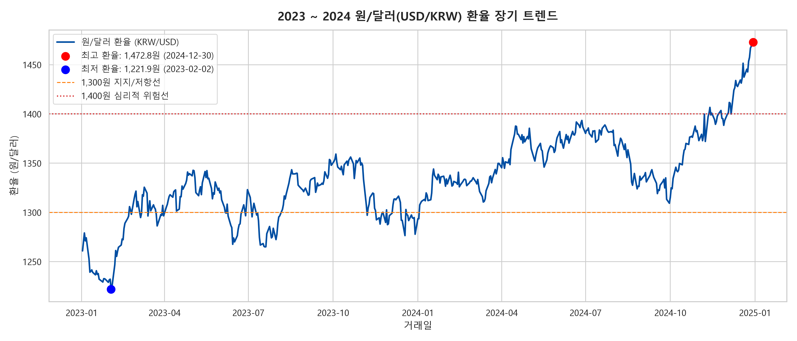
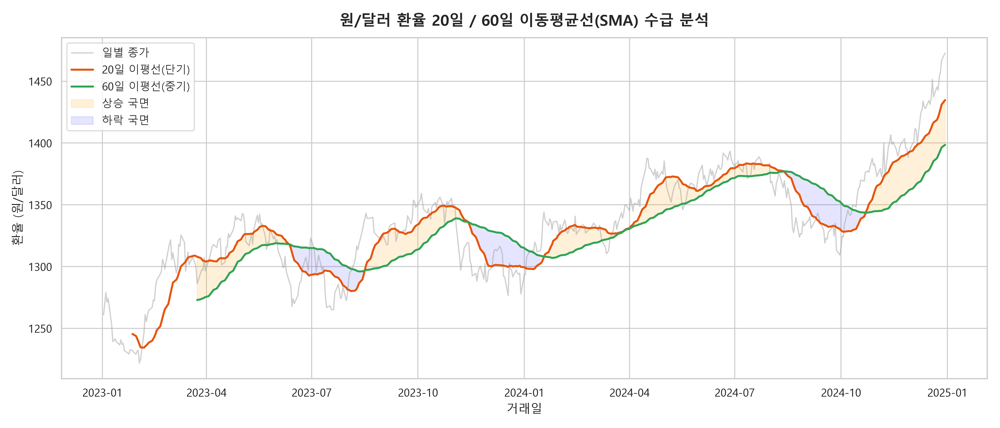
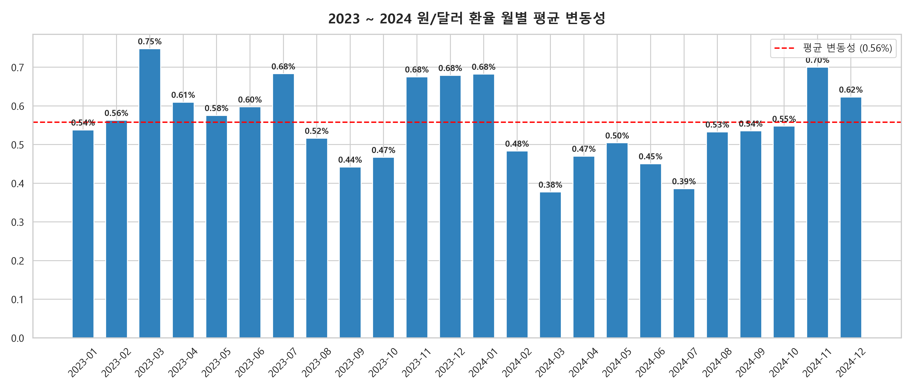
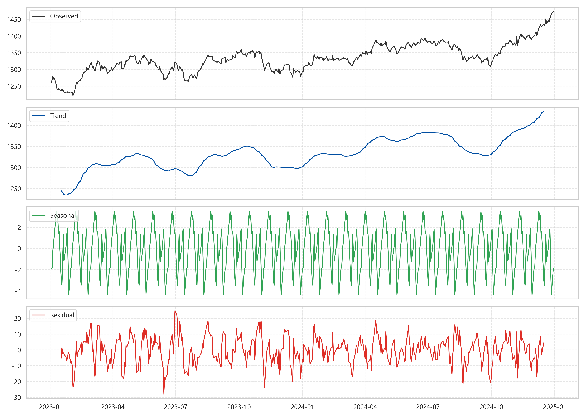
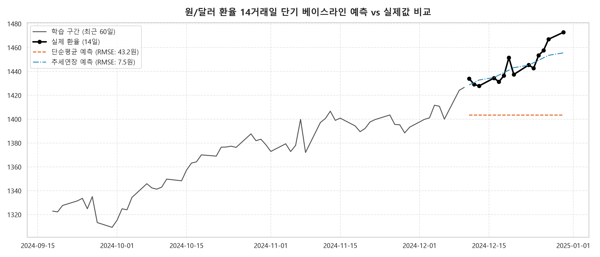
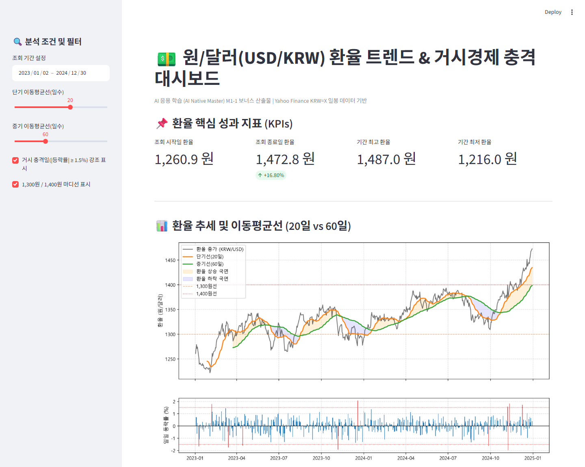
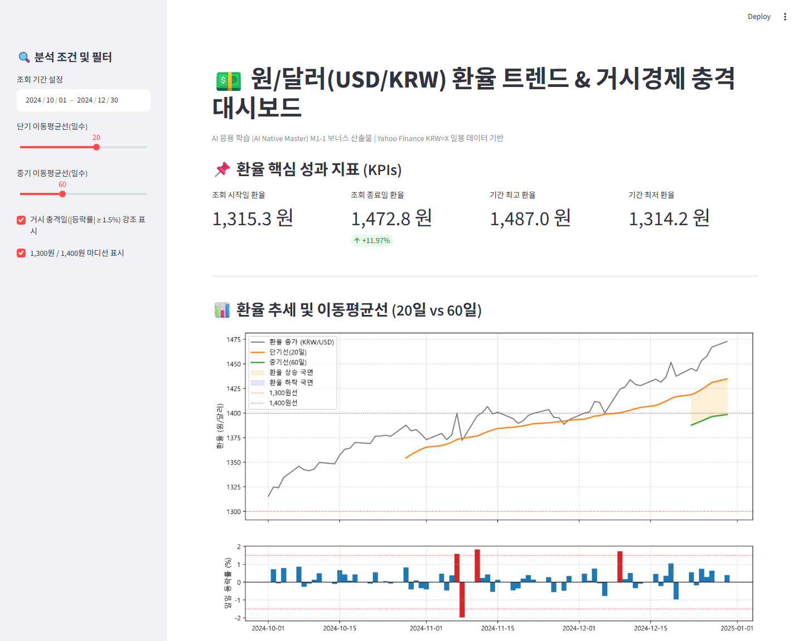
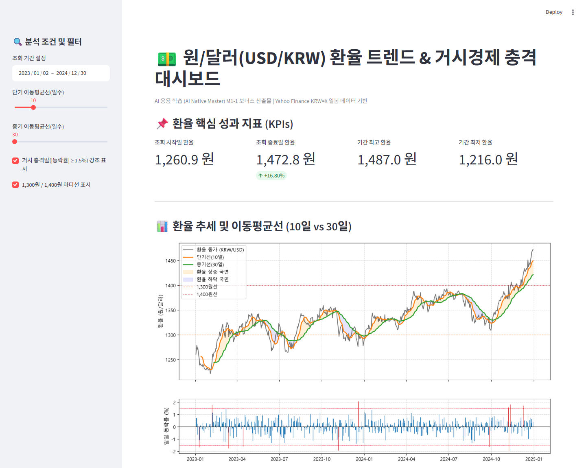

# 2023~2024년 원/달러(USD/KRW) 환율 추이 및 변동성 분석 보고서

- 과정 / 과제: AI 응용 학습 (AI Native Master) — M1-1
- 분석 대상: 원/달러 일별 환율 (`KRW=X`, Yahoo Finance)
- 분석 기간: 2023년 1월 2일 ~ 2024년 12월 30일 (총 521거래일)

## 요약

2023~2024년 2개년 동안 원/달러 환율은 1,260.91원에서 1,472.80원으로 **+16.80%** 상승했다(저점 1,221.95원 대비 +20.53%). 2024년 한 해 전체 261거래일 중 196일(75.1%) 동안 단기 20일 이동평균선이 중기 60일선 위에 머무르며 원화 약세 흐름이 이어졌고, 11월 중순 1,400원 선을 종가 기준으로 넘어선 뒤 연말까지 1,400원대 후반에 안착했다. 월별 변동성은 미 실리콘밸리은행(SVB) 사태가 있었던 2023년 3월(0.75%)과 미 대선 직후인 2024년 11월(0.70%)에 가장 높았으며, 일일 변동폭이 ±1.5%를 넘긴 급변동일은 총 11거래일로 집계됐다.

---

## 1. 분석 주제 및 선정 배경

### 1.1 분석 주제
2023년부터 2024년까지의 원/달러 일별 환율 시계열을 대상으로 장기 추세, 장단기 이동평균 수급 흐름, 월별 변동성, 급변동 이상치 구간을 점검하고 단기 베이스라인 예측의 한계를 확인한다.

### 1.2 선정 배경
- **실무 활용도**: 환율은 국내 수출입 기업의 매출·원가와 자금 운용에 직접적인 영향을 미치는 핵심 거시 지표다.
- **시계열 패턴 확인에 적합한 기간**: 2023~2024년은 한미 기준금리 역전 장기화, 미 연준(Fed) 금리 정책 변화, 미 대선, 2024년 12월 국내 정치 변수 등 대내외 이벤트가 집중되어 추세와 단기 충격이 비교적 뚜렷하게 드러나는 구간이다.
- **데이터 접근성 및 재현성**: 별도 인증 키 없이 Yahoo Finance API로 일관된 일별 시계열을 수집할 수 있어 누구나 동일한 결과를 재현하기 쉽다.

---

## 2. 핵심 분석 질문

1. **장기 추세와 주요 가격대**: 2023~2024년 원/달러 환율은 지속적으로 상승 흐름을 보였는가? 저점과 고점은 각각 언제였으며, 1,300원과 1,400원 가격대는 어떤 지지·저항 역할을 했는가?
2. **이동평균 교차 신호**: 20일 이동평균선(약 1개월)과 60일 이동평균선(약 1분기)의 교차는 환율 상승 국면과 조정 국면을 구분하는 지표로 유효했는가?
3. **변동성과 급변동 구간**: 월별 변동성이 유독 높았던 시기는 언제이며, 일일 등락률 ±1.5%를 넘어선 11거래일은 어떤 대내외 이슈와 맞물려 발생했는가?

---

## 3. 데이터 개요 및 전처리 기준

| 항목 | 내용 |
| :--- | :--- |
| 출처 | Yahoo Finance (`yfinance` 패키지, 티커 `KRW=X`) |
| 수집 기간 | 2023-01-02 ~ 2024-12-30 |
| 데이터 건수 | 521거래일 (최소 기준 100건 충족) |
| 주요 컬럼 | `Date`, `Open`, `High`, `Low`, `Close`(기본 분석 대상), `Volume` |
| 결측치 현황 | 원본 기준 0건 확인 |

### 전처리 및 기준 설정 근거
- **결측치 처리 (`ffill`)**: 외환 시장 휴장 시 공식 기준 환율은 직전 거래일 종가가 그대로 유지된다. 평균값이나 선형 보간으로 채우면 이후 시점의 가격 정보가 과거로 섞여 시계열 인과가 훼손되므로, 결측치가 발생할 경우 직전 유효 값을 승계하는 `ffill` 방식을 기준으로 정했다(본 데이터셋은 원본 결측치 0건).
- **이상치 처리 (보존 후 별도 식별)**: 전산 오류(0원 등 비정상 수치)가 아닌 실제 시장 급변동은 삭제할 경우 거시 충격 분석 자체가 불가능해진다. 이에 일일 등락률 절댓값이 1.5% 이상인 날(총 11거래일)을 `Shock_Flag`로 별도 표기해 삭제하지 않고 원인 해석 대상으로 남겼다.
- **집계 단위 선택**: 환율은 금리 발표나 지정학 이슈에 당일~수일 단위로 반응하므로 일별(Daily) 데이터를 기본 분석 단위로 사용했다. 다만 기간별 시장 불안정도를 한눈에 비교하기 위한 변동성 지표는 20거래일 표준편차의 월별(Monthly) 평균으로 집계했다.
- **라이선스 및 이용 범위**: 본 데이터는 Yahoo Finance 이용 약관에 따라 개인 학습 및 비상업적 분석 목적으로만 사용했으며, 상업적 재배포를 목적으로 하지 않는다.

---

## 4. 분석 결과 및 시각화

### 4.1 2개년 환율 추이 및 주요 가격대 (1,300원 / 1,400원)

- **기간 시작 / 종료 종가**: 2023-01-02 `1,260.91원` → 2024-12-30 `1,472.80원` (`+16.80%`)
- **기간 최저 / 최고**: 종가 기준 최저 `1,221.95원` (2023-02-02, 장중 최저 `1,216.0원`) / 최고 `1,472.80원` (2024-12-30, 장중 최고 `1,487.04원`·2024-12-27)
- **관찰 내용**: 2023년 한 해 동안 1,300원 선을 중심으로 등락하던 환율은 2024년 들어 상단이 점차 높아졌다. 2024-04-16 장중 고가 `1,399.96원`(종가 `1,387.67원`)으로 1,400원 선에 근접한 뒤 여름철 잠시 숨 고르기를 거쳤으나, `2024-11-06` 장중 및 `2024-11-12` 종가 기준으로 1,400원을 넘어서며 연말까지 1,400원대 후반을 유지했다.

---

### 4.2 20일 / 60일 이동평균선 추이 및 교차 구간

- **상승 전환(골든크로스)**: `2023-08-16` (1,338.74원), `2024-01-19` (1,337.66원), `2024-10-23` (1,376.63원) 세 차례에 걸쳐 20일선이 60일선을 상향 돌파했으며, 돌파 이후 모두 수개월간 환율 상승 흐름이 이어졌다.
- **하락 전환(데드크로스)**: `2023-06-12`, `2023-11-14`, `2024-08-13` (1,369.54원)에 단기 조정 국면이 나타났으나 하락 폭은 제한적이었다.
- **정배열 비중**: 2024년 전체 **261거래일 중 196일(75.1%)** 동안 20일선이 60일선 위에 위치해 원화 약세 흐름이 연중 지배적이었다.

---

### 4.3 월별 평균 롤링 변동성 (20거래일 표준편차)

- **전체 평균 변동성**: 24개월 평균 `0.56%`
- **변동성 상위 월**: `2023년 3월 (0.75%)`, `2024년 11월 (0.70%)`, `2023년 7월·12월 및 2024년 1월 (각 0.68%)`, `2024년 12월 (0.62%)`
  - 2023년 3월은 미국 실리콘밸리은행(SVB) 파산 여파와 연준 통화정책 불확실성이 겹친 시기였고, 2024년 11~12월은 미 대선 결과에 따른 관세 우려와 국내 정치 변수가 연달아 작용한 구간이다.
- **변동성 하위 월**: `2024년 3월 (0.38%)`, `2024년 7월 (0.39%)`은 뚜렷한 방향성 없이 좁은 범위에서 횡보했다.

---

### 4.4 시계열 분해 (보너스 심화 A: 추세·계절성·잔차)

- **적용 모델**: 환율 변동 폭이 1,220~1,470원 범위에서 비교적 일정한 절대 진폭을 유지하므로 가법 모형(`Y = Trend + Seasonal + Residual`, 주기 `period=20` 영업일)을 적용했다.
- **추세(Trend)**: 일별 등락을 걷어낸 장기 추세선은 2024년 8~9월 일시 눌림 이후 10월부터 연말까지 가파른 우상향을 그린다.
- **잔차(Residual)**: 2024년 11~12월 구간에 상·하방으로 큰 스파이크가 몰려 있다. 통상적인 월간 주기나 완만한 추세로 설명되지 않는 단기 외부 충격이 집중됐음을 뜻한다.

---

### 4.5 14거래일 단기 베이스라인 예측 및 한계 점검 (보너스 심화 B)

- **검증 구간**: 마지막 14거래일 (`2024-12-11` ~ `2024-12-30`)
- **모델별 가정 및 오차(RMSE)**:
  - **단순 이동평균(Naïve SMA)**: 직전 14일 평균(`1,403.40원`)이 그대로 유지된다고 가정 → **RMSE `43.19원`**
  - **선형 추세 연장(Linear Drift)**: 직전 14일 상승 기울기가 그대로 이어진다고 가정(`1,428.67원 → 1,455.58원`) → **RMSE `7.50원`**
- **해석 및 한계**:
  - 검증 기간인 12월 중순~말은 비상계엄 이후 환율이 단방향으로 계속 올라간 특수 구간이어서, 직전 상승 기울기를 연장한 Drift 모델의 오차(`7.50원`)가 일시적으로 낮게 나왔다.
  - 그러나 환율은 정책 개입, 금리 발표, 정치 변수에 따라 하루 만에도 방향이 꺾일 수 있다. 과거 가격 기울기를 직선으로 늘리는 방식은 추세가 반전되는 시점에 오차가 빠르게 커지는 한계가 있어, 실제 의사결정용 예측 모델이 아니라 기준선(Baseline) 확인 용도로만 해석해야 한다.

---

## 5. 웹 대시보드 구현 및 탐색 시나리오 (보너스 과제 1)

`app.py`를 Streamlit으로 구성해 기간과 이동평균 일수, 마디선·충격일 표시 여부를 직접 바꿔가며 확인할 수 있게 만들었다. 로컬 실행(`streamlit run app.py`) 후 조건별 화면을 캡처해 동작을 검증했다.

### 5.1 전체 기간 기본 화면 (`2023-01-02 ~ 2024-12-30`, `20일 vs 60일`)

- 상단 KPI 카드에 시작가(`1,260.9원`), 종료가(`1,472.8원`, `+16.80%`), 기간 장중 최고(`1,487.0원`)·최저(`1,216.0원`)가 요약되며, 하단 보조 차트에서 ±1.5% 초과 충격일이 빨간 막대로 구분된다.

### 5.2 시나리오 1: 연말 1,400원 돌파 구간 확대 (`2024-10-01 ~ 2024-12-30`)

- 사이드바 조회 기간을 2024년 4분기로 좁혀 확인한 화면이다(`?start=2024-10-01&end=2024-12-30`).
- 3개월간 `1,315.3원 → 1,472.8원(+11.97%)` 상승 흐름과 함께, 11월 7~11일(미 대선 전후)과 12월 9일(계엄·탄핵 정국)에 빨간 충격 막대가 집중적으로 발생한 양상이 한눈에 드러난다.

### 5.3 시나리오 2: 이동평균 민감도 비교 (`10일 vs 30일`)

- 단기선을 `10일`, 중기선을 `30일`로 줄여 확인한 화면이다(`?short=10&long=30`).
- 기본 설정(`20일/60일`)보다 추세 전환 신호는 빠르게 잡히지만, 횡보 구간에서 교차가 잦아져 거짓 신호(Whipsaw)가 늘어나는 트레이드오프를 직접 비교할 수 있다.

---

## 6. 핵심 인사이트

각 항목은 그래프와 데이터에서 확인된 **관찰(Fact)**, 배경에 대한 **원인 추정(Why)**, 실무 관점의 **제안(Action)**으로 구분해 정리했다.

### 6.1 1,400원 선 상향 돌파와 고환율 구간 장기화
- **관찰 (Fact)**: 2023-02-02 저점 `1,221.95원`에서 2024-12-30 `1,472.80원`까지 `+250.85원(+20.53%)` 상승했다. Yahoo Finance 일봉 기준 2024-04-16 장중 `1,399.96원`으로 1,400원 선을 위협한 뒤, 2024-11-06(고가) 및 2024-11-12(종가) 1,400원을 넘어서면서 연말까지 1,400원 밑으로 내려오지 않았다.
- **원인 추정 (Why)**: 한미 기준금리 역전차(최대 2.0%p)가 장기화되면서 달러 보유 선호가 이어졌고, 추가 상승을 예상한 수출 기업들이 달러 환전을 미루며 국내 시장 내 달러 공급이 줄어든 영향이 컸던 것으로 보인다.
- **제안 (Action)**: 수입 원자재 비중이 높은 기업은 1,400원대를 단기 이상 구간으로만 가정하기보다, 중기 사업 계획 환율의 기준 범위를 상향 조정하고 선물환 등 환헤지 비중을 점진적으로 높이는 방안을 검토할 필요가 있다.

### 6.2 2024년 정배열 장기화(75.1%)와 60일선 지지 역할
- **관찰 (Fact)**: 2024년 261거래일 중 196일(75.1%) 동안 20일선이 60일선 위에 머물렀다. 특히 `2024-01-19`(1,337.66원)와 `2024-10-23`(1,376.63원) 골든크로스 이후 뚜렷한 상승 구간이 이어졌다.
- **원인 추정 (Why)**: 1,350~1,380원 구간에서 외환당국의 구두개입과 속도 조절이 반복됐으나 글로벌 강달러 흐름 자체를 되돌리지 못했고, 단기 조정 시마다 결제성 달러 매수세가 60일선 부근에서 재유입된 것으로 해석된다.
- **제안 (Action)**: 자금·외환 실무에서 20일·60일선 골든크로스 발생 시점을 환헤지 비중 확대 검토 기준으로 삼고, 60일선 부근 조정 구간을 달러 결제 대금 분할 매수 시점으로 활용하는 보조 규칙을 운영해 볼 수 있다.

### 6.3 급변동일(11거래일)의 집중 발생과 연말 정치·정책 변수
- **관찰 (Fact)**: 2년간 일일 등락률 ±1.5%를 넘긴 날은 총 11거래일이며, 최대 상승일은 `2023-12-19 (+2.07%)`, 최대 하락일은 `2024-11-08 (-1.98%)`이었다. 2024년 11월 미 대선 주간(`11-07 +1.58%`, `11-08 -1.98%`, `11-11 +1.83%`)에 3차례 연속 충격이 나타났고, `12-03` 비상계엄 당일 장중 고가 `1,442.21원` 급등에 이어 `12-09` 종가 `1,424.22원 (+1.73%)`으로 다시 ±1.5% 임계치를 넘겼다.
- **원인 추정 (Why)**: 평소 월평균 변동성이 `0.38~0.56%` 수준으로 관리되던 외환 시장이 미국 관세 정책 변화와 국내 정치 불확실성 같은 대형 외생 이벤트에 노출되면서, 단기 위험 회피 심리가 환율에 즉각 반영된 것으로 판단된다.
- **제안 (Action)**: 일일 변동폭이 ±1.5%를 넘거나 20일 롤링 변동성이 장기 평균(`0.56%`) 대비 크게 높아지는(`0.68%` 이상) 시기에는 일시적 시장 과열 가능성이 크므로, 대규모 일괄 환전을 피하고 분할 결제 및 단기 유동성 점검 체제로 전환하는 기준을 마련하는 것이 합리적이다.

---

## 7. 결론 및 한계점

### 7.1 결론
2023~2024년 원/달러 환율은 2023년 1,300원대 박스권 형성 → 2024년 상반기 상단 확대 → 2024년 11월 1,400원 돌파 및 연말 1,472.80원 안착의 흐름을 보였다. 이동평균선과 변동성 지표를 함께 살펴보면 환율의 중기 방향성과 이벤트성 급변동 구간을 비교적 명확하게 구분할 수 있다.

### 7.2 한계점
- **단변량 지표의 한계**: 본 분석은 원/달러 환율 자체의 가격 시계열만 다뤘으며, 미국 달러 인덱스(DXY), 한미 국채 금리차, 국제 유가, 외국인 증시 순매수 등 외부 설명 변수와의 다변량 상관관계는 계량 모델에 포함하지 않았다.
- **외생 이벤트 예측 불가**: 2024년 12월 비상계엄 사례처럼 비정형 정치·정책 변수는 과거 환율 수치만으로 사전에 포착할 수 없으므로, 정량 지표와 별도로 뉴스·정책 모니터링이 병행되어야 한다.

---

## 8. AI 사용 로그

| 구분 | 사용 작업 | 사용 이유 | 검증 방법 |
| :---: | :--- | :--- | :--- |
| 1 | `yfinance` 데이터 수집, 전처리 및 노트북(`analysis.ipynb`) 실행 코드 작성 | 반복적인 수집·인덱싱·차트 출력 코드 작성 시간 단축 | `usdkrw_processed.csv` 행 수(521일), 결측치(0건), 시작·종료·최고·최저가, 이상치 11일을 파이썬으로 직접 재계산해 일치 여부 확인 |
| 2 | 시각화 5종 및 Streamlit 대시보드(`app.py`) 레이아웃 구현 | 마디선·구간 음영·사이드바 필터 UI의 빠른 구현 및 대안 탐색 | 로컬 환경에서 `analysis.py`와 `streamlit run app.py`를 직접 실행하고, 생성된 PNG 8종의 한글 출력과 화면 수치를 육안·스크립트로 점검 |
| 3 | 보고서 초안 작성 후 문체 정리 및 수치 재검증 | 보고서 가독성 개선 및 초안 단계의 수치 오기재 점검 | 초안에 적혔던 RMSE·월별 변동성·2024년 거래일 수를 원본 CSV 계산값과 1:1 대조해 불일치 항목을 전량 수정하고, 과장된 표현을 실무 보고서 어조로 다듬음 |
